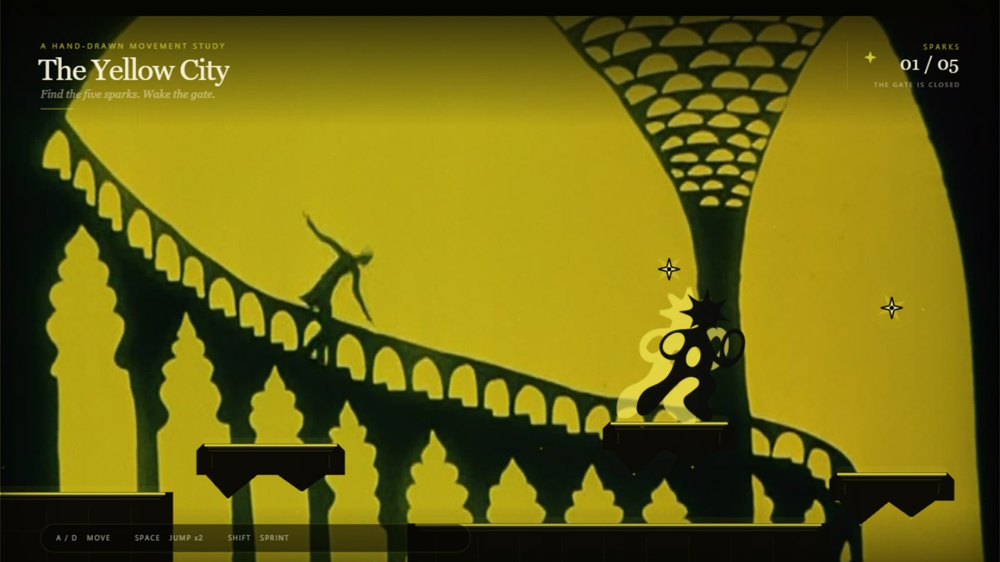

# The Yellow City

A playable, hand-drawn side-scrolling movement prototype built with **Phaser 4 + TypeScript + Vite**. It is a first step toward a Fancy Pants–style platformer: a sketchbook character runs through a yellow-and-ink city, collects five sparks, and wakes the gate at the end of the street.



## Run it

Requires Node.js `^20.19` or `>=22.12`.

```bash
npm install
npm run dev
```

Open <http://localhost:5173>. For a production build:

```bash
npm run build
npm run preview
```

`npm run build` type-checks with `tsc --noEmit` before bundling. Add `?debug` to the URL to show Arcade Physics hitboxes.

## Controls

| Action | Keyboard | Touch |
| --- | --- | --- |
| Move | `A` / `D` or `←` / `→` | left / right buttons |
| Jump | `Space`, `W`, or `↑` | jump button |
| Double jump | press jump again in the air | tap jump again |
| Sprint | hold `Shift` | — |
| Restart (end card) | `R` or `Enter` | **Run Again** button |

Jump height is variable: tap for a short hop, hold for a full jump. The controller also includes coyote time and a jump buffer, so a jump pressed just before landing still counts.

The goal: collect **five sparks**, then enter the gate at the far right. On phones, play in landscape; a rotate prompt appears in portrait.

## What is in this prototype

- 1280×720 internal resolution, 2880 px side-scrolling world, fixed HUD
- custom movement: ground/air acceleration, drag, sprint, variable jump, double jump, coyote time, jump buffering
- camera follow with a deadzone, world bounds, and fall recovery
- hand-drawn platforms with gold keylines, collectible sparks, a gate-opening sequence, and an end card
- responsive `FIT` scaling, touch controls on coarse-pointer devices, a portrait rotation prompt
- all assets local; no external APIs or runtime services

## Project layout

| Path | Purpose |
| --- | --- |
| `src/main.ts` | Phaser config, base resolution, gravity, optional physics debug |
| `src/game/GameScene.ts` | level, character controller, camera, HUD, collectibles, gate, ending |
| `src/style.css` | page shell, loading screen, frame, mobile rotate prompt |
| `public/assets/` | processed background and hero sprite sheets used at runtime |
| `art-source/` | original supplied artwork (not loaded directly) |
| `scripts/prepare_assets.py` | turns the source art into alpha PNG sprite sheets |
| `docs/preview.jpg` | preview image used above |

## Rebuilding the art

The source run cycle is a single horizontal strip of eight ink drawings on white paper. The preparation script converts paper luminance to transparency, recolors the ink, detects and separates the eight drawings, scales them, and aligns them to a shared baseline in a fixed 320×360 grid. It also writes a gold keyline version used as a readability outline and re-encodes the background.

```bash
py -m pip install -r scripts/requirements.txt
npm run assets
```

If you replace the source images, keep `art-source/hero-run-source.png` as one horizontal strip with eight separated drawings. The detector assumes eight ink columns; adjust `MIN_COMPONENT_PIXELS` or `ART_SCALE` in the script if your drawing spacing differs.

## Tuning notes

- Global physics gravity is in `src/main.ts`; movement constants (`RUN_SPEED`, `SPRINT_SPEED`, `JUMP_SPEED`, etc.) are at the top of `GameScene.ts`.
- Level geometry and spark positions are the `PLATFORMS` and `SPARKS` arrays in `GameScene.ts`.
- The hero's Arcade body is `74×270` source pixels with offset `(123, 74)` at `BASE_SCALE = 0.58`. If you change the art scale, update the body so the feet and hitbox stay aligned.
- The eight hand-drawn poses are run frames. Airborne states reuse frames 4–6 with a small body tilt; idle falls back to frame 0. Dedicated jump, fall, and landing art is the natural next art task.

## Next steps

- Add idle, take-off, fall, land, and hurt animation frames.
- Add one-way platforms, ledge grabs, wall jumps, and a dash/slam to deepen the Fancy Pants feel.
- Add audio: footstep ticks, a jump whoosh, a spark chime, and a gate tone (synthesizable or tiny local files).
- Author additional rooms and a checkpoint system.
- Grow toward multiplayer: start with a deterministic fixed-step controller and an authoritative server loop, then interpolate remote players and reconcile local input. Keep visuals and input separate from netcode so desktop and mobile share one controller.
- Mobile polish: PWA install, safe-area layout for notches, and an optional sprint gesture.
- Move the level into data and add automated playtest smoke tests.

## Credits

Character strip and city backdrop were supplied by the project owner. The prototype, asset preparation, and interface were built for this project with Phaser 4, TypeScript, and Vite.
